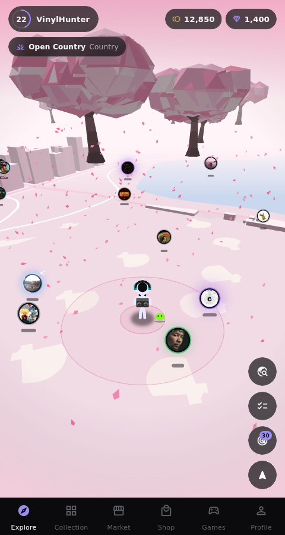
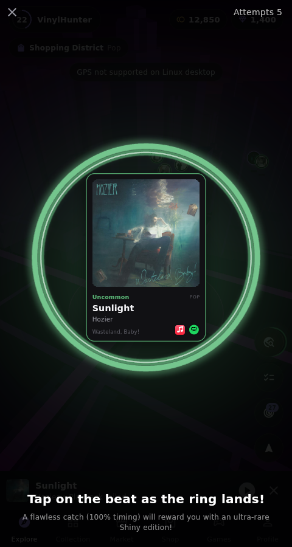
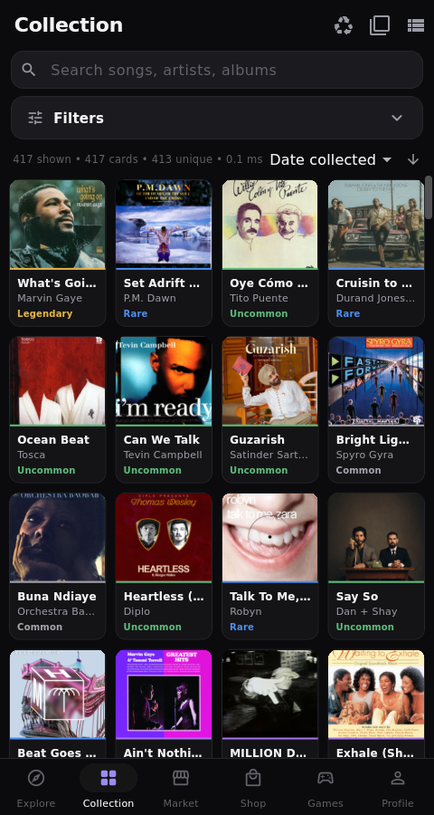
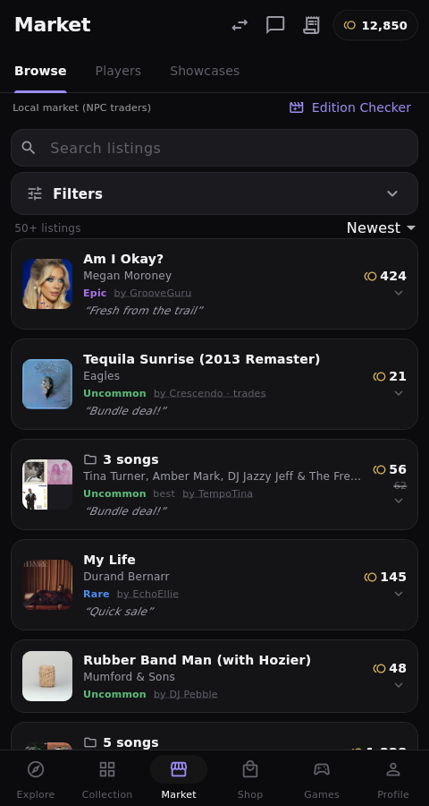
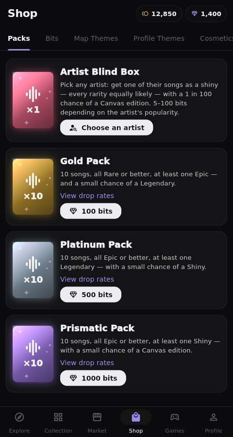
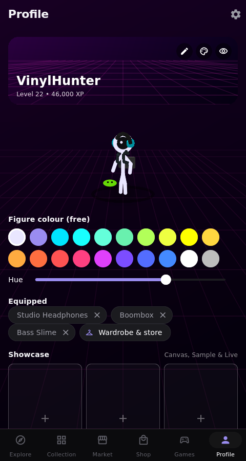
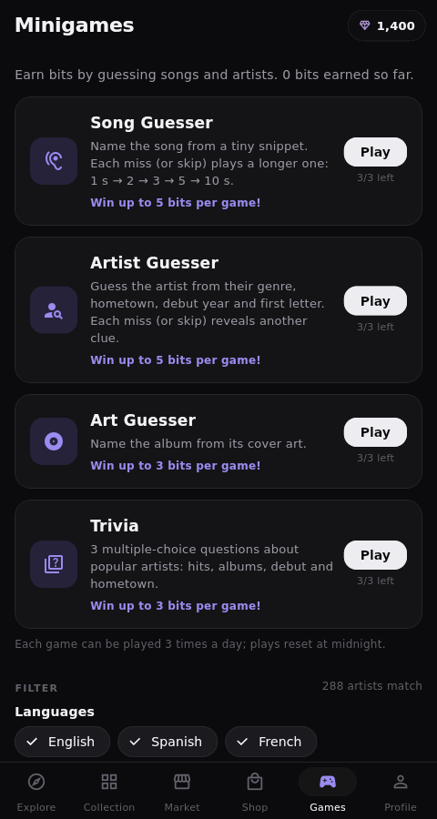

# Tunetrail

**Walk the real world, catch songs, build a collection and trade with other players.**

Tunetrail is a location-based music collecting game for Android, Windows and Linux.
Songs float around you on a stylised 3D map of your neighbourhood. Walk up to one,
tap the ring on the beat to catch it, and it joins your collection as a card you can
play, showcase, list on the market or trade.

> **Status:** public beta (Beta v1.0.x). Downloads are on the
> [Releases](../../releases) page.

  
  
  

## How it plays

- **Explore.** Your real location, drawn as a 3D city with real building heights.
  Songs spawn every few minutes; what's around depends on where you are (genre
  zones), the time of day, and your favourite artists (10× more likely).
- **Catch.** Tap as the ring lands on the beat of the song. A flawless 100% hit turns
  the card into an ultra-rare **Shiny**. Out of range? Buy the song with coins and
  catch it from where you stand.
- **Rarities and editions.** Every song has one rarity, Common → Legendary, from its
  popularity. Rare spawns can come as numbered editions: **Canvas** (the music video
  fills the card, #1–10), **Live** (live performance footage, #1–5) and **Sample**
  (the song and the record it samples, #1–5).
- **Collect.** Search, filter and sort thousands of cards, build playlists and listen
  to them, scrap spares for coins.

  
  
  

- **Trade.** A player market with single songs and folders of up to 20, auctions
  (with Buy It Now and anti-sniping), offers on any song in another player's
  collection, showcases, player search and direct messages.
- **Shop.** Gold, Platinum and Prismatic packs, the Artist Blind Box, map themes
  (Synthwave, Sakura, Aurora, Candy…), profile themes, outfits, backpacks and pets.
- **Minigames.** Song Guesser, Artist Guesser, Art Guesser and Trivia, tuned to the
  languages and genres you listen to, for bits every day.
- **Accounts.** Google sign-in, unique usernames, push notifications (Android), and
  report and block tools.

  

## Music and rights

Tunetrail doesn't host or sell music. Song information, 30-second previews, cover art
and video clips are **streamed** from Deezer and Apple and never stored on the device,
and every card links to the song on Apple Music and Spotify. Rights holders can ask
for changes or removal — see *Profile → Settings → Copyright & DMCA* in the game.

## Project layout

| Path | What's there |
|---|---|
| `lib/` | The Flutter app (map renderer, game logic, screens) |
| `packages/tunetrail_core/` | Shared Dart code: rarities, market engine, auctions, usernames, world spawns |
| `server/` | The multiplayer server (Dart, Postgres) and its Docker image |
| `deploy/` | Docker Compose + Caddy for hosting the server |
| `docs/` | Setup guides ([multiplayer & hosting](docs/multiplayer-setup.md), [admin build](docs/admin-build.md)) |

## Licence

© Tunetrail. All rights reserved. The source is published for reference; it may not
be copied, redistributed or published (including to app stores) without permission.
