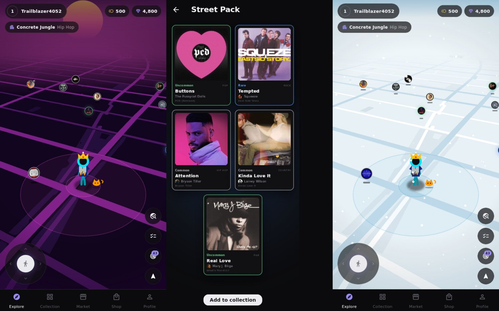

# Tunetrail

A location-based music collecting game. Walk around the real world, catch
popular songs floating on the map, complete quests, open packs, trade on a
player market and build playlists you can actually listen to.

Built with **Flutter** (Dart, AOT-compiled to native code) from one codebase
for **Android, iOS, Windows**, plus macOS and Linux.



---|---|---|---|
| Player stick figure at the centre, songs float and glow by rarity | Virtualised grid, instant filter & sort | Beat-ring catch minigame with song preview | NPC/online listings, trades, showcases |

---

## Downloads

Every push builds through GitHub Actions (`.github/workflows/build.yml`) and
publishes a **GitHub Release** with:

* `Tunetrail-windows-x64-setup.exe` (installer) and `Tunetrail-windows-x64.zip` (portable: extract, run `Tunetrail.exe`)
* `Tunetrail-linux-x64.tar.gz` (extract and run `./tunetrail`; needs GTK 3 and GStreamer with the "good" plugins)
* `Tunetrail-android-universal.apk` (any device) and per-ABI APKs (`arm64` suits most phones)

### Android signing

Release APKs are signed with Tunetrail's own release key (not the Android debug key, which antivirus apps commonly flag). Locally, signing reads `android/key.properties` (git-ignored). In CI, add these repository secrets:

| Secret | Value |
|---|---|
| `TUNETRAIL_KEYSTORE_BASE64` | `base64 -w0 tunetrail-release.jks` |
| `TUNETRAIL_KEYSTORE_PASSWORD` | keystore password |
| `TUNETRAIL_KEY_ALIAS` | `tunetrail` |
| `TUNETRAIL_KEY_PASSWORD` | key password |

Without the secrets, CI falls back to the debug key and prints a warning. Keep the keystore safe: updates must be signed with the same key. Sideloaded apps from developers not registered with Google still show a Play Protect "unrecognised developer" prompt. Distributing through a Play Console testing track (or completing Android developer verification) removes it.

## Gameplay

* **3D world.** A custom renderer turns OpenStreetMap vector data into a stylised ground plane: main roads, parking lots, water, parks, fields and plazas, with **no ordinary buildings or driveways** (only mega-buildings like stadiums, airports, factories and malls, which are extruded as low 3D blocks). Your 3D stick figure walks on it at the centre, with distance fog toward the horizon. Drag to orbit the camera, pinch or scroll to zoom, and use Q/E on PC.
* **Genre zones.** Every spawn point is scored against the land around it (≈160 m radius), so genres spawn more often where they fit:

  | Zone | Boosted genres | Where |
  |---|---|---|
  | Open Country | Country | Farmland, meadows, open land with few roads/buildings |
  | Concrete Jungle | Hip-Hop | Dense blocks: many buildings, tight street grids |
  | Waterfront | Blues, Jazz | Rivers, lakes, harbours, coastline |
  | Industrial Grid | Electronic, Dance | Industrial estates, factories, warehouses, data centres, large corporate buildings |
  | After Hours | R&B | Bars, lounges, clubs, late-night dining strips |
  | Iron & Stone | Metal | Rail yards and tracks, quarries, cemeteries, heavy infrastructure |
  | Arena & Open Road | Rock | Highways, stadiums, arenas, music venues, rocky terrain |
  | Shopping District | Pop, Top Hits | Malls, retail streets, shops, cinemas |
  | Neon Campus | K-Pop & Asian | Campuses, arcades, karaoke, theme parks, Korean food |
  | Plaza & Shore | Latin, Reggaeton, Brazilian | Public squares, markets, beaches, football pitches, Latin American food |
  | Woodland / Old Town / Café Row / Island Time | Folk / Classical & Film / Soul & Alternative / Reggae | Forests / churches, museums & theatres / cafés & record shops / beaches |

  The map shows the zone you're standing in; tap it to see every zone.
* **Wild spawns.** The world is split into ~200 m cells and 15-minute windows. Each cell/window is hashed into a seed, so **everyone in the same place at the same time sees the same songs**, with no server needed. Time of day biases genres (electronic & R&B at night, folk & pop in the morning…).
* **Rarities:** Common (grey), Uncommon (green), Rare (blue), Epic (purple), Legendary (gold). A song's rarity is half *how big the artist is* and half *where the song ranks among that artist's songs*. Tiny artists span Common to Rare; superstars are mostly Epic/Legendary, with Rare reserved for their least-played tracks (deep cuts, remixes, edits). Popularity comes from **Last.fm all-time play counts** when a Last.fm API key is configured (Settings, or `--dart-define=LASTFM_API_KEY=…` / the `LASTFM_API_KEY` repo secret in CI); otherwise Deezer's popularity rank is used, which is less accurate. Rarer spawns glow brighter, and Legendaries get rotating light rays.
* **Shiny variants** (1/128): an animated glint sweeps across the card and across the rarity name everywhere it's shown (collection, market, playlists, showcases). The label still just says the rarity ("Legendary"), with the glint.
* **Editions:**
  * **Movie** (~3.5% of wild spawns, only for songs with a music video): the card is a full-size, looping clip of the music video with the details overlaid. Clips are Apple's free music-video previews from the iTunes Search API, downloaded once and cached.
  * **Sample**: for songs in the sample library, the card shows the song's waveform aligned with the waveform of the record it samples, Tracklib-style. *Play breakdown* plays the original, then any transformation (sped up/slowed, or chopped), then crossfades into the song at the exact point it uses the sample. There's no free sample API (WhoSampled has none, and MusicBrainz rarely records samples), so the library is curated in `lib/data/samples.dart`. It currently holds **Kanye West – I Wonder ← Labi Siffre – My Song**. The debug menu has a sync tuner to refine an entry's alignment.
* **One copy per variant:** song × rarity × shiny × edition is a variant, and you own at most one of each (a Rare, a shiny Rare and a Movie Rare of the same song are three different cards). Duplicates from catches, packs, trades or returns go straight to the scrapyard for their coin value, with a notice. Buying a variant you already own is blocked.
* **Favourite artists:** add as many as you like. On your profile (and your public showcase) they're an expandable tab with a scrollable list. Each spawn is 10× as likely to be by *one of* your favourites (the boost is for the list as a whole, not per artist), and that artist is picked at random from your list.
* **Character:** idles naturally. It glances around, and after standing still for a while it sits down with headphones (notes float out) or summons a turntable and scratches, then gets up smoothly when you move.
* **Catching:** tap a song within 70 m to open the encounter. The minigame waits for the music to start, then the ring pulses **at the song's BPM, landing on its beats**: tempo comes from Deezer, and the beat grid is found by onset analysis of the decoded audio. Audio runs on SoLoud, so timing is judged against the real playback position. If the music hasn't started after 5 s, the ring starts anyway, unsynced. Every tap shows its timing accuracy. **A 100% perfect tap (within ±0.25% of the beat) always catches the song and turns it shiny**; 99% doesn't. Rarer songs flee more often. A caught card spins and pumps toward you, then settles. After a catch you can **List for sale**, **Quicksell** (send it to the scrapyard), view the card or go back. The preview stops once the song is caught (Settings can keep it playing).
* **Nearby:** tapping a song in the Nearby list turns the camera to face it if it's in range. Otherwise the view pulls up overhead, draws a trail of footsteps along the streets to it (A* routing over the road network), then drops back down facing the song.
* **Camera:** drag to orbit around your character (dragging right turns the view counter-clockwise), pinch or scroll to zoom. On Windows/Linux, press **Alt** to lock the cursor and aim with the mouse like a normal PC game (Alt or Esc releases it). Idle animations wait while you're moving the camera.
* **Quests:** 4 rotating dailies; weekly **Artist Spotlights** (collect N songs by an artist → unlock an exclusive Epic/Legendary card of their biggest hit); **Album completion** (own every track on an album → Legendary card); milestones.
* **Discography browser:** artist pages (picture, top tracks, albums/EPs/singles) and album pages in official track order, showing which tracks you own.
* **Currencies:** **coins** (earned by catching, quests and selling; spent on the player market) and **bits** (bought with real money; spent on packs).
* **Packs** (bits): Street, Genre (pick a genre), Hi-Fi, Platinum (guaranteed Legendary), Prism (guaranteed Shiny). Drop rates are shown in-app.
* **Player market:** listings are **folders of 1–20 songs**. The seller prices each song, and the folder price is their sum unless the seller sets a bundle discount. Buyers can take the whole folder or individual songs. Listings carry a **note** (up to 200 characters), can accept **trade offers** (songs + coins, with a note) for the whole folder, and are browsed as expandable folders. Players can also publish a **showcase** of favourite cards and playlists.
* **Quick list:** after a catch (or from any card), list instantly with your preset price and note for that rarity, or open the composer to set them by hand. Presets live in Settings → Quick-list presets.
* **Scrapyard:** scrap unwanted songs for coins. Payouts grow with the song's streams, rarity and shininess, and one tap selects all your duplicates (keeping your best copy).
* **Playlists:** build them from owned cards, reorder, and play them back (30-second Deezer previews, auto-advance, mini player).
* **Character:** a stylised stick figure. Colour is free to change. Hats, shirts, backpacks and pets are sold in the store.
* **Map themes** (store): Obsidian (default: black, graphite and a soft violet accent), Midnight, Synthwave, Vaporwave (low-poly 3D marble bust and columns rising out of the distant ground), Noir (rain), Vintage Vinyl, Digital Rain, Arctic (snow on deep glacial blues), Magma (embers), Aurora, Sakura (petals, plus low-poly pink sakura trees that fade out as you approach and back in as you leave). Idle headphones and notes recolour to contrast with each theme.
* **Filters:** the collection and the market each have a large *Filters* dropdown with Rarity, Variant (Shiny / Not shiny / Standard / Movie / Sample) and Genre sections (plus Favourites, or Open to trades).

## Developer debug menu

Profile → ⚙ Settings → **Debug menu** switch, then *Open debug menu*:

* Set coin and bit balances (presets up to 10M)
* **Free real-money purchases** (bits bundles, themes and cosmetics granted with no charge), or unlock everything at once
* **Joystick movement** with a speed multiplier (×1–×50); on Windows/Linux, **WASD / arrow keys** move relative to the camera and **Q/E** turn it
* **Teleport:** search any real-world place (OpenStreetMap Nominatim) or pick a preset, then jump there (also on the map's 🔍 button)
* **Spawn a song:** search any song or artist on Deezer and drop it next to you (optionally shiny, in any edition), or one-tap the **Sample edition of I Wonder**
* **Sample sync tuner** (on a Sample card's detail page): nudge where the passage starts in each preview and the speed change, audition it, and save
* Unlimited catch range, respawn nearby songs
* Stress test: add 1k / 10k / 100k random cards, clear the collection, crawl more of the catalog

## Data sources (all free, no API keys)

| What | Source |
|---|---|
| Songs, artists, albums, track order, discographies, cover art, artist photos, 30 s previews | [Deezer public API](https://developers.deezer.com/api) |
| Map data (vector tiles, Shortbread schema) | © [OpenStreetMap](https://www.openstreetmap.org/copyright) contributors, served by [VersaTiles](https://versatiles.org) |
| Place search (teleport) | OpenStreetMap Nominatim |
| Music-video clips (Movie editions) | [iTunes Search API](https://performance-partners.apple.com/search-api) (`entity=musicVideo` previews) |

The catalog is built progressively: genre charts first (instantly playable),
then each genre's most popular artists' top tracks, then related artists
above a fan threshold. **Non-English genres** (Latin, Reggaeton, K-Pop/Asian,
Brazilian, African, Indian) only admit artists with ≥500k Deezer fans, and
genre spawn weights keep the game primarily English-language. The crawl
targets ~60k songs (the debug menu can push it further); the result is cached
locally as JSON lines.

> **Before a public launch:** host your own vector tiles (VersaTiles or any
> Shortbread-schema tile server; see `MapData.sources` in
> `lib/map3d/map_data.dart`) instead of relying on the free public service.
> Deezer previews are 30 s clips; full-track playback needs a licensed provider.

## Performance (100,000+ cards)

The collection (`lib/data/collection.dart`) is stored **column-wise in typed
arrays**, about 26 bytes per card, so 100k cards take ~2.6 MB of RAM and load
from a binary file in milliseconds. Queries filter directly over the arrays,
then sort by packing *(primary key, secondary key, index)* into one 63-bit
integer per card and sorting an `Int64List`. Alphabetical sorts use
precomputed title/artist rank tables, so no strings are compared while
sorting. The UI is a virtualised grid/list that only builds visible cards,
decodes artwork at thumbnail size, and shares one animation clock across
every shiny glint.

`flutter test` includes a 100k-card benchmark (filter, sort by
date/title/artist/rarity, text search, persistence round trip).

## Multiplayer market server

The app runs a **local market** by default (offline, with simulated NPC
traders that list, buy and answer trade offers). For real player-to-player
trading, run the server and switch *Settings → Market → Online*:

```bash
cd server
dart pub get
dart run bin/server.dart --port 8080 --data market.json
```

The client and the server share the same market engine
(`packages/tunetrail_core`), so behaviour is identical. This is a **developer
server**: it has no authentication and trusts client-reported coin balances.
A production deployment should add accounts and server-side balances, and
should verify store receipts on the server.

## Real-money purchases

`lib/game/purchase_service.dart` uses `in_app_purchase` (Google Play Billing /
StoreKit) on Android and iOS. Product IDs are `tt_<id>` (e.g. `tt_bits_550`,
`tt_theme_synthwave`, `tt_hat_crown`); see `lib/game/store_catalog.dart`.
Create matching products in Play Console / App Store Connect. Windows has no
store integration in this build, so use the debug *free purchases* switch.

## Building locally

```bash
flutter pub get
flutter run                      # any connected device / desktop
flutter build apk --release      # Android (Linux/macOS/Windows host)
flutter build windows --release  # Windows (Windows host required)
flutter build ios --release      # iOS (macOS + Xcode required)
flutter test                     # unit tests incl. 100k-card benchmark
```

## Project layout

```
lib/
  data/        models, Deezer client, catalog crawler, collection store, save file
  game/        game controller, spawns, quests, packs/store catalog, market, IAP, GPS/joystick, audio
  map3d/       vector-tile decoder, tile processor (isolate), 3D camera, ground renderer, 3D figure, palettes
  ui/          app shell, map screen (+ themes, markers), screens, widgets (design kit, cards, glint, stick figure)
packages/tunetrail_core/   shared pure-Dart logic: rarities, RNG, market engine (+ tests)
server/                    multiplayer market HTTP server (shelf)
.github/workflows/         CI: tests → Android APKs + Windows exe/installer → GitHub Release
```
